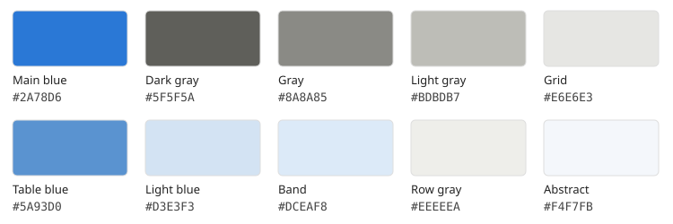

# 蓝灰图表配色参考

参考论文：[Towards Architectural-Level Safety Control](https://arxiv.org/pdf/2610.25791)。
以下色号取自所提供的同源 LaTeX 和 PDF 图形，记录日期为 2026-10-22。
曲线色由 PDF 的 RGB 绘制指令提取，并换算为 8 位 HEX；表格色由源码中的
`\definecolor` 直接取得。下列颜色均有原始文件依据。



## 统计图

| 用途 | HEX | LaTeX 名称 | 原始依据 |
| --- | --- | --- | --- |
| 主要方法、重点曲线 | `#2A78D6` | `PaperBlue` | `sft_qwen_teaser.pdf`、`sft_grid.pdf`、`routing_summary.pdf` |
| 深灰基线 | `#5F5F5A` | `PaperGrayDark` | 同上 |
| 中灰基线 | `#8A8A85` | `PaperGray` | 同上 |
| 浅灰基线 | `#BDBDB7` | `PaperGrayLight` | `sft_qwen_teaser.pdf`、`sft_grid.pdf` |
| 浅灰网格、辅助线 | `#E6E6E3` | `PaperGrid` | `sft_qwen_teaser.pdf`、`sft_grid.pdf` |

原图用同一蓝色的实线和虚线区分两种方法状态，基线使用不同深浅的灰色；
主方法线更醒目，网格和参考线较轻。复用时还应配合线型、标记和文字标签区分系列。
统计图以蓝灰为主，机制示意图可按内容使用辅助色。

## 表格与页面

| 用途 | HEX | LaTeX 名称 | 原始源码名称 |
| --- | --- | --- | --- |
| 数值强调／热图基色 | `#5A93D0` | `PaperTableBlue` | `removalmax` |
| 浅蓝重点单元格 | `#D3E3F3` | `PaperTableBlueLight` | `removal2` |
| 浅蓝行带 | `#DCEAF8` | `PaperTableBand` | `band` |
| 浅蓝对比底色 | `#DCE8F3` | `PaperTableSeparation` | `sepdropbg` |
| 很浅的暖灰行底 | `#EEEEEA` | `PaperTableRow` | `oursrowmain` |
| 弱化文字 | `#7A8187` | `PaperMuted` | `sepmuted` |
| 更浅的弱化文字 | `#9A9A94` | `PaperMutedLight` | `collapsed` |
| 标题摘要框底色 | `#F4F7FB` | `PaperAbstractBg` | `AbstractBgColor` |

表格的色号来自原始 `preamble.tex`；摘要框底色来自原始 `main.tex`。
热图可按需要将 `PaperTableBlue` 与白色混合，例如 `PaperTableBlue!25`，
同时保留数值标签。按钮中的青色属于链接样式，曲线使用上表的主蓝。
class 中标题与超链接的深蓝为 `#000080`，与图表的 `#2A78D6` 分别记录。

## 使用

模板已通过 `preamble.tex` 加载 [colors.tex](colors.tex)，可直接使用命名色：

```latex
\textcolor{PaperBlue}{Highlighted text}
\cellcolor{PaperTableBlueLight}value
```

绘图脚本可使用相同 HEX 常量：

```python
MAIN_BLUE = "#2A78D6"
BASELINE_GRAYS = ["#5F5F5A", "#8A8A85", "#BDBDB7"]
GRID_GRAY = "#E6E6E3"
```

配色以可复用的定义提供；现有图形文件的配色由各自绘图源决定。
